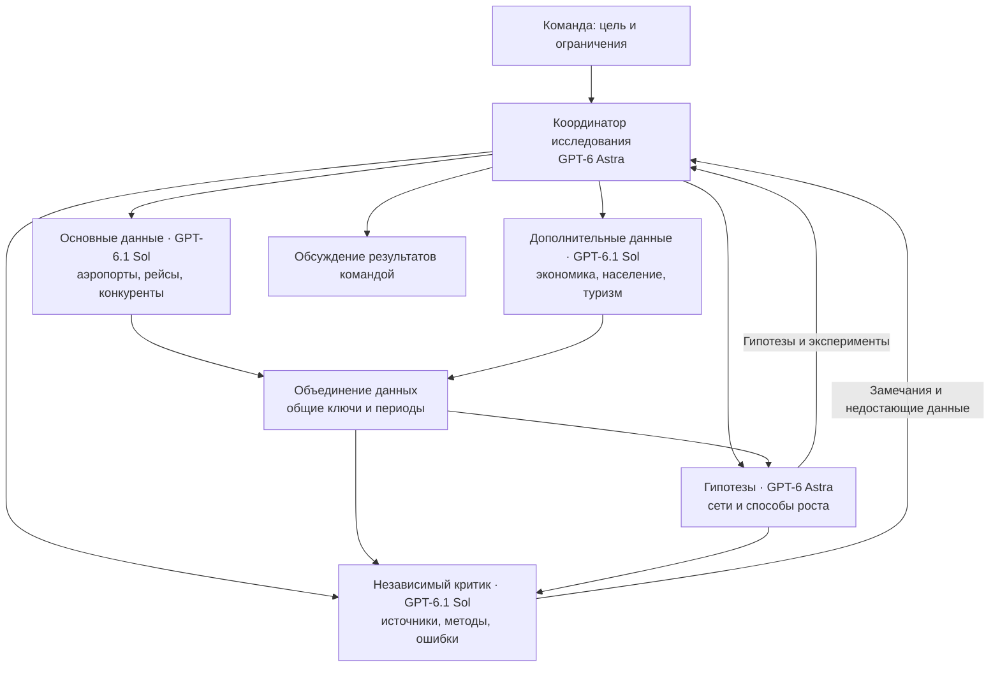
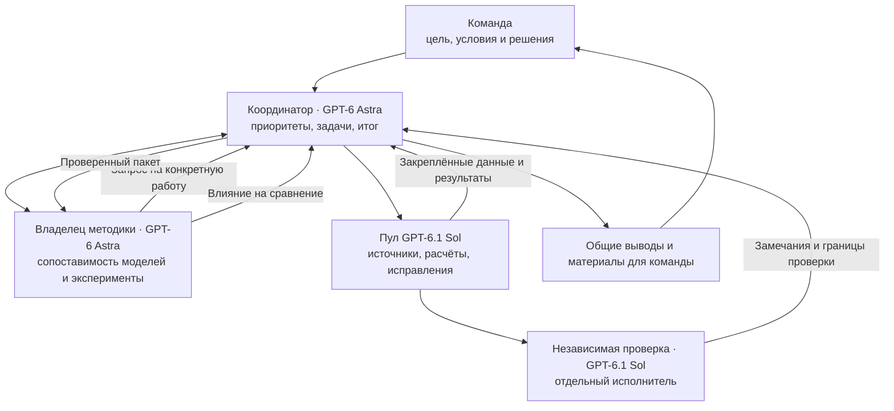
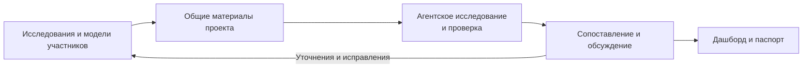

# Использование ИИ в проекте Red Wings

Команда использовала ИИ для исследования авиационного рынка, поиска данных, подготовки и проверки расчётов, а также для объяснения результатов. Существенная часть работы была организована как полуавтономное исследование: участники определяли задачу и критерии результата, а система агентов распределяла поиск, расчёты и независимую проверку между специализированными ролями.

## Инструменты и их задачи

| Инструмент | Для чего использовали |
|---|---|
| **NotebookLM** | Работа с собранными источниками и исследованиями, изучение существующих обзоров и библиографии, поиск вопросов и направлений для дальнейшего анализа. Полученные выводы проверяли по источникам. |
| **Gemini в Antigravity** | Широкий поиск авиационных и социально-экономических данных, исследование городов, конкурентов и методов, анализ видео о маршрутных сетях. Gemini также помогал структурировать и наглядно объяснять собранный материал. |
| **Codex в T3 Code** | Координация исследовательских агентов, сбор и нормализация данных, разработка и воспроизведение расчётов, проверка кода и результатов, подготовка отчётов и визуализаций. |
| **Claude Code и Claude** | Исследование предметной области, подготовка расчётного кода и ведение контекста проекта между рабочими сессиями; Claude также участвовал в подготовке объясняющих материалов. |

В Codex роли распределяли с учётом задачи: Astra использовали для постановки, гипотез и сопоставления моделей, Sol и Terra — для исследования, реализации и независимой проверки. Вывод одного агента передавали другому вместе с исходными материалами и конкретными вопросами для проверки.

## Исследовательская система: данные и гипотезы

Первая крупная система была ориентирована на поиск данных и идей для решения кейса. Координатор на **GPT-6 Astra** разбил исследование на четыре самостоятельных направления: основные авиационные данные, дополнительные источники, генерацию гипотез и независимую методологическую проверку. Гипотезы прорабатывал **GPT-6 Astra**; сбором основных и дополнительных данных и работой критика занимались отдельные агенты **GPT-6.1 Sol**. У каждого направления была своя задача и свой набор результатов; при необходимости оно могло выделить ограниченные независимые подзадачи.

До запуска задали общий договор о данных и оценке. Для каждого набора требовалось указать источник, дату, территорию, период, единицу измерения, покрытие и ограничения. Исходные наблюдения, расчётные признаки и сценарные оценки различались. Неизвестные значения сохранялись как неизвестные; отсутствие найденного конкурента не считалось доказательством его отсутствия.

Гипотезу оформляли через механизм, необходимые данные, ожидаемый результат и способ проверки. Критик оценивал источники, соединение таблиц, корректность показателей, воспроизводимость и влияние возможной ошибки на выбор. Команда получала промежуточные результаты и открытые вопросы, а сбор и проверка выполнялись агентами самостоятельно в заданных границах.

Эта система подготовила исследовательские данные и очередь гипотез для последующего сопоставления сетей. Промежуточные исследования оставались материалом для проверки; они сами по себе не утверждали окончательную стратегию.

## Система сопоставления и проверки моделей

Вторая крупная система была построена вокруг другой цели: сопоставить уже созданные командой модели, проверить их на общих данных и проработать варианты развития сети. Согласовали две постоянные роли на **GPT-6 Astra** и общий ограниченный пул исполнителей и проверяющих на **GPT-6.1 Sol**.

Координатор отвечал за цель, очередь задач и итог. Постоянный агент методики удерживал общие определения, сравнение вариантов, сценарии и ограничения. Координатор распределял работу между исполнителями: они собирали и проверяли источники, воспроизводили модели, исправляли конкретные проблемы и проводили расчёты. Для независимой проверки существенных результатов назначали отдельного исполнителя. Одновременно работало не более четырёх таких исполнителей; они не создавали собственные деревья агентов.

Передача между ролями строилась вокруг конкретного пакета: входные данные, версия кода, команды воспроизведения, результат и его ограничения. Новые данные или исправления сохранялись как отдельная версия. Это позволяло проверить, какой именно расчёт изменился и повлияло ли это на сравнение.

Например, при объединении сетевых программ проверяли, не продаётся ли один и тот же спрос нескольким программам одновременно, достаточно ли кресел на каждом плече и не начисляется ли тариф дважды для поездки с пересадкой. Исправление проверял другой агент, после чего методическая роль оценивала влияние на общее сравнение.

## Подготовка среды и правил работы

Перед длительными запусками команда отдельно формулировала цель, ожидаемые результаты и ограничения. Агентам передавали не только задание, но и рабочее окружение:

- **Контекст задачи:** условия кейса, результаты предыдущих исследований, модели команды и открытые вопросы.
- **Единые определения:** период сравнения, единицы измерения, различие пассажиров и сегментов, общий спрос, кресла, самолёты и затраты.
- **Контракты для ролей:** что агент должен исследовать, какие данные использовать, что сохранить и какие вопросы передать дальше.
- **Границы работы:** собственная область изменений, ограниченный пул исполнителей, запрет самостоятельно менять исходные материалы других участников и подменять неизвестные значения.
- **Проверка и приёмка:** воспроизведение расчётов, независимый ревьюер, конкретные замечания и сохранение ограничений.
- **Обратная связь с командой:** промежуточные результаты, существенные ошибки и решения, требующие выбора человека.

Такая подготовка позволяла агентам продолжать предметную работу самостоятельно, сохраняя общую цель и возможность проверить их выводы. Человек определял приоритеты и принимал решения о спорных допущениях; агенты возвращали аргументы, расчёты и выявленные ограничения.

## Работа команды

Участники параллельно проводили исследования, разрабатывали собственные модели и дашборд. Общий репозиторий использовался для обмена данными, кодом и результатами. Агентская система учитывала новые материалы команды, воспроизводила и сопоставляла расчёты, затем возвращала замечания и подготовленные данные для общего решения.

Факты и расчёты проверяли по источникам и воспроизводимым примерам. Сценарный результат сохранял свои допущения: положительная расчётная величина не объявлялась подтверждённой прибыльностью, а неполные данные — доказанным отсутствием спроса.

## Текст для паспорта

> Команда использовала NotebookLM, Gemini в Antigravity, Codex в T3 Code и Claude Code для исследования источников, анализа конкурентов и рынков, разработки и проверки расчётных моделей и подготовки материалов. В исследовательской системе GPT-6 Astra координировал работу и прорабатывал гипотезы, а агенты GPT-6.1 Sol собирали данные и проверяли методику. Для сопоставления моделей организовали координатора и постоянную методическую роль на GPT-6 Astra, а также ограниченный пул исполнителей и проверяющих на GPT-6.1 Sol. До запуска определили цель, входные данные, единицы измерения, правила работы и критерии проверки. Участники команды сопоставляли результаты, принимали решения и обсуждали ограничения; факты проверяли по источникам, расчёты — воспроизведением и независимыми проверками.

## Материалы проекта

- [Исследование данных, городов и методов](../04_research/README.md).
- [Проверка источников и фактов](../07_verification/README.md).
- [Данные, код и дашборд](https://github.com/Mput13/case_championship/tree/7fcb5ffbed5a4df1df4689c18f33e3cf37b74fab).
