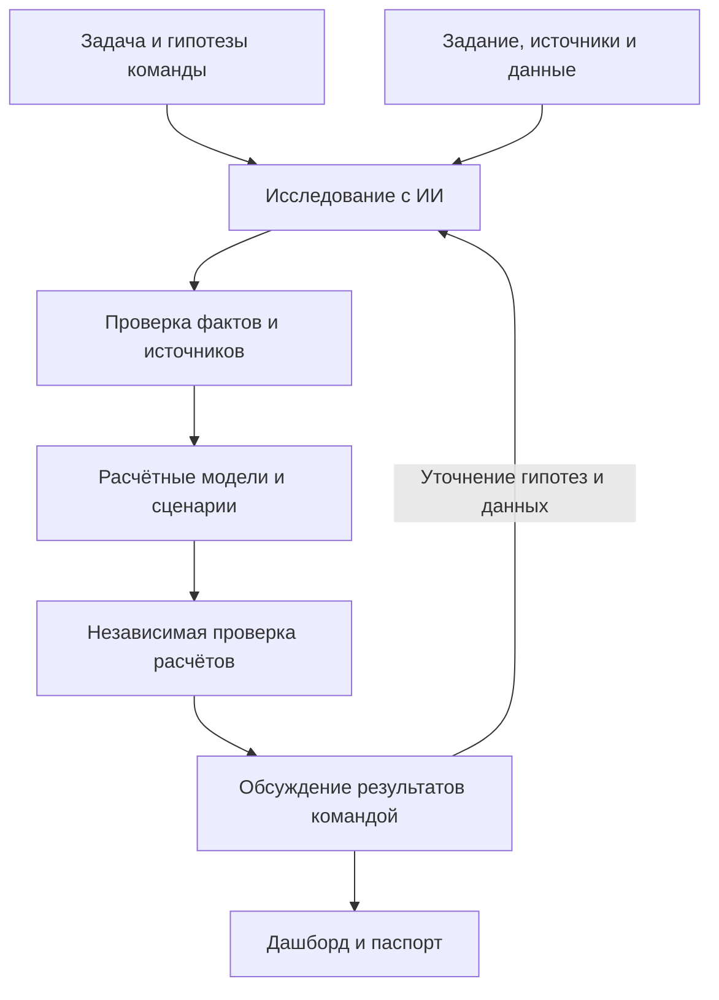
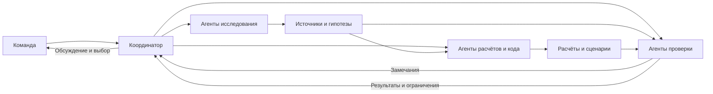
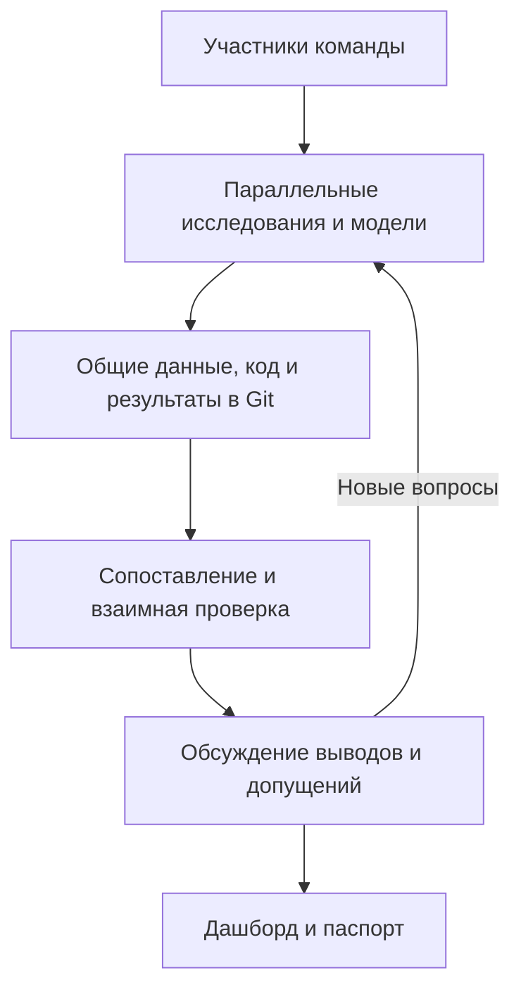

# Использование ИИ в проекте Red Wings

Команда применяла ИИ для поиска и анализа информации, разработки расчётных моделей, проверки результатов и подготовки дашборда и объясняющих материалов. Участники формулировали задачи, сопоставляли результаты и принимали решения; агенты выполняли отдельные исследовательские, программные и проверочные задачи.

## Инструменты

| Инструмент | Применение |
|---|---|
| **NotebookLM** | Работа с собранными документами, исследовательскими материалами и источниками; поиск идей для дальнейшей проверки. |
| **T3 Code и Codex** | Постановка и распределение задач между агентами, исследование данных, написание и проверка кода, сборка материалов. |
| **Claude Code** | Исследование предметной области, разработка расчётов и ведение рабочего контекста проекта. |
| **Gemini, GPT и Claude** | Поиск и анализ информации, генерация гипотез, программирование, независимые проверки и подготовка объяснений. Задачи распределялись с учётом возможностей инструментов. |
| **Python и Git/GitHub** | Воспроизводимые расчёты и проверки, хранение кода, данных, допущений и результатов, обмен изменениями между участниками. |

## Процесс работы

Исследования включали города и аэропорты, конкурентов, маршрутные сети, флот, субсидии и методы оценки спроса. ИИ помогал находить источники и формулировать гипотезы; найденные утверждения проверяли по доступным первоисточникам. Данные, оценки и сценарные допущения фиксировали отдельно.

Для сравнения сетей разрабатывали расчётный код: оценивали спрос, частоты, использование самолётов и экономические показатели. Проверяли входные данные, формулы и воспроизведение результатов. Сохраняли ограничения расчётов и вопросы, для которых открытых данных недостаточно.

## Оркестрация агентов

Работу разделяли между агентами по предметным задачам. Агент-координатор передавал исполнителям конкретные задания и собирал результаты. Для отдельных исследований и расчётов привлекали проверяющих агентов: они сверяли источники, воспроизводили вычисления и искали ошибки. Замечания возвращались исполнителю или координатору для исправления.

Для продолжительной работы использовали отдельные исследовательские направления и ограниченный пул агентов. В заданиях указывали цель, необходимые входы, ожидаемый результат и границы проверки. Контекст передавали через файлы проекта, инструкции и краткие описания состояния работы.

## Работа команды

Участники параллельно исследовали данные, разрабатывали модели и интерфейс, проверяли гипотезы. Результаты и изменения публиковали в ветках Git, после чего команда сопоставляла модели и обсуждала расхождения.

При сопоставлении сохраняли исходные версии моделей и отдельно фиксировали исправления. Результаты сравнивали с учётом различий в периоде, данных и единицах измерения. Команда использовала дашборд для представления вариантов и их расчётных показателей.

## Как проверяли результаты ИИ

- **Источники:** сверяли факты, даты, единицы измерения и применимость данных. Непроверенные сведения оставляли как гипотезы или вопросы для дальнейшего исследования.
- **Расчёты:** воспроизводили результаты, проверяли формулы и граничные случаи, в том числе совместное использование спроса и кресел разными маршрутами.
- **Независимая проверка:** отдельные агенты проверяли исследования и код других исполнителей, формулировали замечания и предлагали исправления.
- **Сценарии и ограничения:** отделяли наблюдаемые данные от оценок и допущений; анализировали чувствительность выводов к изменениям условий.

Например, при проверке исследовательских материалов выявили неподтверждённые показатели и смешение разных авиационных метрик. При сопоставлении сетевых моделей отдельно проверили, что один и тот же спрос и кресла не учитываются повторно в разных программах. Результаты таких проверок использовали для исправления расчётов и уточнения выводов.

## Текст для паспорта

> В проекте использовали NotebookLM, T3 Code, Codex, Claude Code и языковые модели GPT, Gemini и Claude. С их помощью команда исследовала данные и конкурентов, формулировала гипотезы, разрабатывала расчётные модели и готовила материалы для представления результатов. Работа распределялась между агентами по направлениям исследования, расчёта и проверки. Участники команды сопоставляли результаты в общем репозитории и совместно обсуждали выводы. Данные и утверждения проверяли по источникам, расчёты воспроизводили и проверяли на граничных случаях; допущения и ограничения фиксировали отдельно.

## Материалы проекта

- [Исследование данных, городов и методов](../04_research/README.md).
- [Проверка источников и фактов](../07_verification/README.md).
- [Данные, код и дашборд](https://github.com/Mput13/case_championship/tree/7fcb5ffbed5a4df1df4689c18f33e3cf37b74fab).
