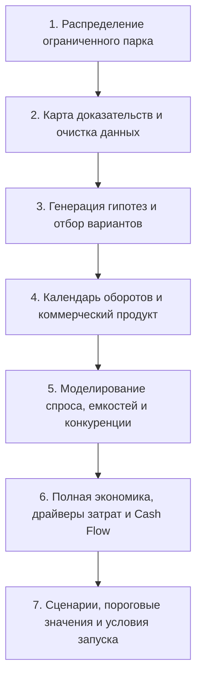

# Методология и архитектура принятия сетевых решений Red Wings: от ограниченного парка воздушных судов к доказанной экономике маршрутной сети 2027–2028

## Вводный раздел: суть задачи и управленческая развилка (чтение на 1,5–2 минуты)

Перед авиакомпанией Red Wings стоит прикладная стратегическая задача: куда направить жестко ограниченные провозные емкости отечественного парка региональных реактивных самолетов (в первую очередь существующие SSJ-100 / RRJ-95 с двигателями SaM146 и ожидаемые импортозамещенные SJ-100 с двигателями ПД-8). 

Ключевая развилка кейса формулируется предельно конкретно:
1. **Создание нового регионального хаба** — концентрация флота на новой базе с организацией стыковочных волн (банков пересадок), базированием экипажей, линейного технического обслуживания (ТО) и ночной стоянки.
2. **Расширение прямых межрегиональных связей без нового хаба** — добавление радиальных лучей из уже освоенных базовых аэропортов (прежде всего Екатеринбург / Кольцово — SVX, а также Жуковский / Домодедово) либо выстраивание кольцевых цепочек через станции назначения без переноса центра тяжести затрат.

Главная методическая ошибка, которую часто совершают при поверхностном анализе подобных кейсов, — ранжирование городов по абстрактным баллам (население, валовой региональный продукт, пассажиропоток аэропорта, радиус 500 км) с последующим механическим перемножением «среднего тарифа» на «паспортную вместимость 100 кресел». В реальной авиации такой подход приводит к тяжелым кассовым разрывам. Высокий пассажиропоток аэропорта может быть на 90% занят агрессивным базовым конкурентом с крупнофюзеляжным флотом, тариф «от» на сайте агрегатора не имеет ничего общего со средней чистой выручкой за вычетом сборов, а положительный переменный вклад отдельного рейса в воздухе моментально обнуляется на земле расходами на пустые перегоны, аренду ангаров, простой резервных бортов и каннибализацию собственных существующих маршрутов.

Наш аналитический процесс выстроен как строгая сквозная доказательная цепочка. Мы не принимаем решения по единому субъективному баллу. Мы превращаем исходные рыночные наблюдения в выполнимые календарные обороты самолетов, моделируем совместный потребительский выбор с учетом конкурентов и альтернативных видов транспорта, рассчитываем полную себестоимость по контрактным драйверам и сопоставляем каждый вариант по строгому правилу прироста к базовому контуру.

### Базовый глоссарий для профессионального диалога

Для исключения двусмысленности в анализе зафиксированы строгие авиационные определения, используемые на всех этапах:

* **OD (Origin – Destination, истинная корреспонденция):** начальный пункт отправления и конечный пункт назначения фактической поездки пассажира (например, Нижний Новгород — Кемерово). Пассажир совершает **одну** поездку OD независимо от того, летит ли он прямым рейсом или с пересадкой через промежуточный узел.
* **Плечо (Flight Leg / Segment, сегмент перелета):** отдельный физический беспосадочный перелет воздушного судна между двумя конкретными аэропортами по расписанию (взлет — посадка). Пассажир с пересадкой оформляет один билет OD, но физически занимает кресло на **двух** последовательных плечах.
* **Блок-часы (Block Hours):** время с момента начала движения воздушного судна на вылет (закрытие дверей и начало буксировки со стоянки) до полной остановки у гейта и выключения двигателей в аэропорту прибытия. Это ключевой драйвер переменной летной себестоимости, оплаты летных экипажей и ресурса компонентов планера и силовой установки.
* **KEEP (Базовый сценарий сохранения status quo):** утвержденный контур существующей сети, расписания, флота и финансовых обязательств авиакомпании, который сохраняется, если проект не запускается. Любая новая программа $P$ оценивается исключительно как прирост над базой: **$P − \text{KEEP}$**. Прирост учитывает как дополнительную выручку, так и потерю выручки донорских рейсов или каннибализацию существующих линий.
* **Gross vs Net выручка:** 
  * *Gross (валовая выручка):* полная цена, уплачиваемая пассажиром, включая аэропортовые таксы, сборы систем бронирования, топливные надбавки и применимый НДС.
  * *Net (чистая выручка / Net Yield):* сумма, которая фактически достается авиакомпании за перевозку на пассажиро-километр или за весь маршрут после очистки от внешних обязательных сборов и транзитных такс аэропортов. В финансовой модели учитывается строго Net Yield.

---

## Архитектура сквозного анализа: от вопроса к границам доказанности

Анализ разбит на 7 последовательных исследовательских этапов. На каждом шаге мы четко разграничиваем, что мы доказали на основе фактов, а что остается расчетным допущением или неизвестной величиной (**UNKNOWN**).

### Этап 1. Вопрос о распределении ограниченного парка
* **На какой вопрос отвечаем:** Каким располагаемым объемом парка и летных часов обладает авиакомпания на горизонте 2027–2028 годов, и как распределить эти ВС между сохранением текущей сети (KEEP) и новым развитием?
* **Каким входом пользуемся:** Контракт кейса (`context/00_brief/case5_requirements.md`, `context/26_strategy_reset_20261110/contract.md`), реестр парка Red Wings (текущие 19–20 бортов RRJ-95), график возможных поставок SJ-100 с двигателями ПД-8 не ранее второй половины 2027 года.
* **Что считаем:** Доступные самолето-дни, календарный график ввода бортов, потребность в техническом резерве (минимум 1 резервный борт на группу из 4–5 эксплуатируемых ВС).
* **Какой вывод делаем:** На первом этапе (2027–2028 гг.) целевая программа развития должна формировать компактную сеть из **8–12 уникальных аэропортовых пар** к концу 2028 года. Программа не может рассчитывать на одномоментный ввод десятков новых самолетов. Вводится жесткое ограничение: **zero-new-Tu214** (новые Ту-214 не привлекаются под региональный проект). Парк RRJ-95 и новый SJ-100/ПД-8 разделяются в учете.
* **Что НЕ доказано:** Точные сроки сертификации и поставок SJ-100 с двигателями ПД-8. Условие «поставка с H2-2027» является граничным условием учебного кейса, а не подтвержденным производственным графиком ОАК. Поэтому задержка или непоставка нового типа является обязательным сценарием стресс-теста.

### Этап 2. Карта доказательств и очистка первичных данных
* **На какой вопрос отвечаем:** Какие открытые источники данных отражают реальное поведение пассажиров, а какие являются грубыми прокси, непригодными для прямого финансового счета?
* **Каким входом пользуемся:** Помесячная статистика аэропортов (пакет P01-MONTHLY, 86 наблюдений), данные ЕМИСС (форма № 1-турфирма, форма № 62073 по коллективным средствам размещения), опубликованные расписания систем бронирования (пакет P02, 2274 правила продуктов).
* **Что считаем:** Проверяемость и сопоставимость показателей.
* **Какой вывод делаем:** 
  1. *Открытый пассажиропоток аэропорта (Airport Total)* не равен числу пассажиров на конкретной паре городов (OD). Аэропорт с трафиком 3 млн пассажиров может обслуживать преимущественно московский коридор и чартеры в Анталью.
  2. *Опубликованные рейсы* не тождественны доступным к продаже креслам и не доказывают наличие свободного самолета на базе. Рейс в расписании может быть сезонным чартером, разовым рейсом или круговым транзитом.
  3. *Минимальная рекламная цена «от»* на агрегаторах не является средней чистой доходной ставкой (Net Yield).
  4. *Статистика гостиниц ЕМИСС 62073* измеряет число ночевок командированных и туристов, прибывших всеми видами транспорта (поезд, личный автомобиль, автобус), и не может приравниваться к авиационному спросу.
* **Что НЕ доказано:** Точная историческая матрица корреспонденций (True OD) на направлениях, где прямые рейсы отсутствовали. Значения годового рынка взяты как авторские сценарные ориентиры (priors), а не как инструментально измеренный факт.

### Этап 3. Генерация гипотез и фильтрация направлений
* **На какой вопрос отвечаем:** Какие из 20 исследованных городов и 35 исходных сетевых гипотез обладают объективными предпосылками для размещения флота или открытия линий?
* **Каким входом пользуемся:** Аналитические паспорта городов (Stage A research по Уфе, Нижнему Новгороду, Казани, Тюмени, Самаре, Перми и др.).
* **Что считаем:** Наличие инфраструктуры базирования, конкурентное окружение, пересечение с маршрутами соперников, потенциал формирования стыковок.
* **Какой вывод делаем:** Город не может быть выбран на основе высокого интегрального рейтинга. Каждый кандидат получает статус: *оценен*, *условен*, *объединен*, *работа не выполнена* или *отклонен с обоснованием*. Отсутствие данных (**UNKNOWN**) не является основанием для экономического отказа, но блокирует принятие финансовых обязательств до проведения проверок.
* **Примеры пересмотра исходных гипотез:**
  * *Пример 1 (Отказ от выбора по рейтингу аэропорта — кейс Казани KZN):* Казань обладала высокими исходными баллами по пассажиропотоку и инфраструктуре. Однако детальный аудит показал, что KZN уже является базовым трансферным хабом для Nordwind Airlines (до 40% трансфера на ключевых направлениях) и домашней базой «ЮВТ Аэро». Более того, специальная скидка аэропорта Казани для базовых перевозчиков предоставляется только на воздушные суда вместимостью **не менее 150 кресел** (Boeing 737 / Airbus A321). 100-местный SSJ-100 под эту льготу юридически не попадает. Гипотеза развертывания нового доминирующего хаба в Казани была пересмотрена: город сохранен только как возможное точечное дополнение существующих линий.
  * *Пример 2 (Пересмотр гипотезы базы в Нижнем Новгороде GOJ):* У Red Wings в Нижнем Новгороде действует договор линейного технического обслуживания RRJ-95 до формы Daily Check включительно. На первом этапе предполагалось объявить GOJ готовой новой базой. Ревизия установила: договор на Daily Check оперативного обслуживания не означает наличие ангарных мощностей, сертификации для двигателей ПД-8, постоянного базирования экипажей и гарантированных ночных стоянок. Гипотеза «полноценного хаба GOJ» была понижена до статуса «станция ночевки / оборотный пункт».

### Этап 4. Календарь, расписание и коммерческий продукт
* **На какой вопрос отвечаем:** Как связать заявленные частоты в реальный выполнимый оборот конкретных самолетов с учетом нормативов летного времени, регламентов аэропортов и стыковочных волн?
* **Каким входом пользуемся:** Нормативы рабочего времени экипажей (Приказ Минтранса № 381), расчетное время обслуживания на земле (turnaround time 40–50 мин), календарь на 24 месяца 2027–2028 гг. (с учетом високосного 2028 года).
* **Что считаем:** Блок-часы на каждое плечо, недельный налет на борт, время стыковки (Minimum Connecting Time — MCT), пересечение оборотов.
* **Какой вывод делаем:** Нельзя оценивать экономику сети путем «умножения одной недели декабря на 52»! Декабрьская неделя в наших материалах использовалась строго как диагностический стресс-тест геометрии оборотов. Годовой расчет строится на реальном помесячном календаре. Стыковочный банк требует одновременного схождения бортов в узле: если самолеты прибывают с разницей в 3 часа, качественный продукт пересадки исчезает.
* **Что НЕ доказано:** Наличие подтвержденных слотов в пиковые часы и юридически утвержденного аэропортового MCT в 90 минут для трансфера багажа между региональными рейсами.

### Этап 5. Общий спрос, провозные емкости и конкуренция
* **На какой вопрос отвечаем:** Сколько реальных пассажиров купят билеты Red Wings в условиях конкуренции с прямыми рейсами других авиакомпаний, кривыми стыковками через Москву и наземным транспортом?
* **Каким входом пользуемся:** Модель дискретного потребительского выбора (Logit Choice Model, пакет P05/P06), параметры чувствительности к тарифу и полетному времени, расписания конкурентов (пакет P02).
* **Что считаем:** Полезность каждого альтернативного маршрута для пассажира:
  $$V_i = \beta_0 - \beta_{\text{fare}} \cdot \text{Fare}_i - \beta_{\text{time}} \cdot \text{TotalTime}_i - \beta_{\text{conn}} \cdot \text{IsConnection}_i$$
  Вероятность выбора рейса Red Wings: $P_i = \frac{e^{V_i}}{\sum_j e^{V_j}}$, где в знаменателе учитываются конкуренты и «отказ от полета / поездка на поезде» (outside option).
* **Какой вывод делаем:** 
  1. *Сеть — это совместный перерасчет, а не сумма автономных линий.* Открытие нового сегмента меняет загрузку смежных плеч.
  2. *Каннибализация собственных продаж:* Пассажир, полетевший новым прямым рейсом Red Wings, может быть «снят» с существующего стыковочного рейса Red Wings через Екатеринбург или рейса авиакомпании-партнера. Прирост спроса оценивается строго «нетто».
  3. *Паспортные кресла не гарантируют продажи:* Нельзя механически подставлять $S = 100$ кресел как подтвержденный инвентарь на каждом плече. На коротких взлетно-посадочных полосах или при высоких летних температурах действуют ограничения по коммерческой загрузке (payload-range restriction); часть мест блокируется под центровку.
* **Что НЕ доказано:** Эмпирические коэффициенты эластичности спроса на конкретных региональных рынках. Валидация модели P05 показала 0 наблюдений натурного holdout по истинным OD и медианную относительную погрешность сегментного прокси 62,05% на 25 строках. Сезонность группы «Аэрофлот» не доказывает сезонность тонких региональных линий. Эти параметры защищаются как калиброванные сценарные допущения (priors).

### Этап 6. Полная экономика программы, драйверы затрат и денежные потоки (Cash Flow)
* **На какой вопрос отвечаем:** Окупает ли полученная выручка полные добавленные издержки авиакомпании на владение, эксплуатацию и обслуживание флота, и не приведет ли проект к кассовому разрыву?
* **Каким входом пользуемся:** Каталог 127 контрактных драйверов затрат (пакет P04, `cost_ranges.csv`, `cash_rules.json`).
* **Что считаем:** Поэлементный расчет: $\text{Себестоимость} = \sum (\text{Ставка}_k \times \text{Драйвер}_k)$.
  * *Пример формулы затрат на плечо:*
    $$\text{Cost}_{\text{leg}} = \text{MTOW} \cdot R_{\text{взлет-посадка}} + \text{Pax} \cdot R_{\text{пассажирский терминал}} + \text{Fuel}_{\text{тонн}} \cdot R_{\text{керосин}} + \text{BH} \cdot (R_{\text{ТО ППО}} + R_{\text{экипаж/час}})$$
  * *Далее суммируются постоянные затраты:* аренда/лизинг ВС (борт-месяц), периодическое ТО по календарю (C-Check / двигатели), зарплата эскадрильи (FTE/месяц), командировочные расходы и гостиницы экипажей, плата за базирование и ангар, накладные расходы запуска станции.
* **Какой вывод делаем:** 
  * *Положительный переменный вклад (Contribution Margin) $\neq$ Прибыль бизнеса.* Рейс может покрывать керосин и аэропортовые сборы в конкретном вылете, но проект в целом останется глубоко убыточным из-за лизинговых платежей за простаивающие самолеты, расходов на содержание базы и резерва.
  * *Разница между P&L и Cash Flow:* Начисление субсидий по Постановлению № 1242 происходит постфактум (часто с задержкой в 2–4 месяца), а авансы за авиатопливо, аэропортовое обслуживание и лизинг списываются предоплатой. Без моделирования ликвидности проект с формально положительной годовой маржой может обанкротиться на 3-м месяце из-за кассового разрыва.
* **Что НЕ доказано:** Фактические ставки ТО и лизинга самолетов SJ-100 с двигателями ПД-8. Использование аналогов от SSJ-100 с SaM146 — это вынужденное сценарное допущение. Субсидия по Постановлению № 1242 не является гарантированной (требует победы в конкурсе и софинансирования субъекта РФ). Доходы от коммерческой перевозки почты и экспресс-грузов в багажниках SSJ оставлены в статусе **UNKNOWN** (выручка по ним не бралась в зачет окупаемости).

### Этап 7. Сценарии, пороговые значения и условия запуска
* **На какой вопрос отвечаем:** При каких критических отклонениях внешних параметров (цена авиатоплива, задержка поставок ВС, срез субсидий, отказ конкурентов уступать долю) решение должно быть немедленно остановлено или скорректировано?
* **Каким входом пользуемся:** Матрица сценариев (Базовый, Осторожный, Задержка поставок, Отсутствие новых ВС).
* **Что считаем:** Точки безубыточности (Break-even load factor, Break-even net yield, минимально необходимый налет часов).
* **Какой вывод делаем:** Итоговая рекомендация формулируется не как «слепо запускаем вариант А», а как набор жестких пороговых условий допуска:
  $$\text{Если } \text{Subsidy} = 0 \implies \text{Программа } X \text{ закрывается; запускается консервативный вариант } Y.$$

---

## Сквозной практический пример: Хаб в Уфе (UFA-P04) против базы в Кольцово (UFA-P05)

Чтобы увидеть, как эти принципы работают на практике, рассмотрим прямое сопоставление двух реальных программ из нашего пула гипотез (`variants/UFA/research_v1/programme_candidates.json`, зарегистрированные кандидаты `UFA-P04-BANK-EW` и `UFA-P05-DIRECT2`, сверенные по материалам `expert_brief/show_materials.md`).

Оба варианта претендуют на **один и тот же ресурс**: группу из **2 рабочих воздушных судов** регионального класса и выполняют одинаковое физическое число вылетов — **24 плеча в неделю** (4 пары направлений $\times$ 3 оборота туда-обратно).

| Параметр сравнения | Программа А: Стыковочный узел UFA (`UFA-P04-BANK-EW`) | Программа Б: Прямые рейсы из SVX (`UFA-P05-DIRECT2`) | В чем фундаментальная разница и где ловушка? |
|---|---|---|---|
| **География 4 пар маршрутов** | **UFA – GOJ** (Нижний Новгород) **UFA – MRV** (Минеральные Воды) **UFA – TOF** (Томск) **UFA – KEJ** (Кемерово) | **SVX – GOJ** (Нижний Новгород) **SVX – MRV** (Минеральные Воды) **SVX – TOF** (Томск) **SVX – KEJ** (Кемерово) | В варианте А рейсы сходятся «крестом» в Уфе. В варианте Б самолеты работают радиально из существующего хаба в Екатеринбурге. |
| **Физический объем работы** | 4 пары $\times$ 3 RT = **24 вылета/нед.** | 4 пары $\times$ 3 RT = **24 вылета/нед.** | Число взлетов и посадок одинаково, но рынки и полетное время разные. |
| **Блок-часы (налёт) в неделю** | Уфа: 110 + 210 + 195 + 200 = 715 мин/RT. При 3 RT: $715 \times 2 \times 3 = 4290$ мин = **71,5 блок-часов/нед.** (35,75 ч на борт). | SVX: 140 + 225 + 170 + 175 = 710 мин/RT. При 3 RT: $710 \times 2 \times 3 = 4260$ мин = **71,0 блок-часов/нед.** (35,5 ч на борт). | Разница всего 30 минут налета в неделю! Выбор нельзя сделать по летной геометрии — решают доходы и наземные издержки. |
| **Коммерческий продукт** | Локальные пассажиры Уфы + **трансфер Восток–Запад** (GOJ/MRV $\leftrightarrow$ TOF/KEJ) через стыковочный банк 90 минут в Уфе. | Прямые пассажиры Екатеринбурга. Пассажиры из Уфы попадают на эти направления только через существующий фидер UFA–SVX. | Уфа пытается продавать пересадку на тонких рынках; SVX монетизирует емкий домашний рынок Екатеринбурга. |
| **Располагаемые кресла (Inventory)** | Расчетное $24 \times S$ кресло-этапов. Фактическое $S$ — **UNKNOWN** (зависит от жары в MRV и длины ВПП в KEJ). | То же $24 \times S$ кресло-этапов. Фактическое $S$ — **UNKNOWN**. | Нельзя автоматически подставлять $S=100$. Одинаковые кресла не означают одинаковый спрос и одинаковую коммерческую загрузку. |
| **Базирование, экипажи и ТО** | Требуются распределенные ночевки в регионах (GOJ/TOF/MRV/KEJ), либо открытие постоянной базы в Уфе с эскадрильей и линейной станцией. Статус: **UNKNOWN**. | Опора на действующую базовую инфраструктуру, эскадрилью и ангарное ТО в Екатеринбурге (SVX). Затраты минимальны. | Программа в Уфе несет колоссальные риски накладных расходов на открытие новой базы, которые отсутствуют в SVX. |
| **Резервирование и сбойные ситуации** | При сбое одного борта в Кемерово «разваливается» вечерний банк в Уфе: трансферные пассажиры застревают, срываются вылеты в Нижний и Минводы. Своего резерва нет. | Сбой подхватывается общесетевым флотом Red Wings, базирующимся в Кольцово. Время ввода резерва минимально. | Узел на 2 самолетах без резерва операционно крайне хрупок. |
| **Влияние на существующие продажи (P − KEEP)** | Открытие прямого рейса UFA–TOF **забирает** собственных пассажиров Red Wings, которые раньше летали по маршруту UFA–SVX–TOF. | Дополнительные частоты усиливают присутствие в SVX, снижая постоянные затраты на единицу налета. | В Уфе часть выручки — это просто перекладывание денег из одного кармана авиакомпании в другой. |
| **Итоговый финансовый результат** | **UNKNOWN** (зависит от признания субсидий 1242 и реальных затрат на базу). | **UNKNOWN** (требует подтверждения спроса на добавленные частоты). | Ни один из вариантов не объявляется слепым победителем до прогона через общую финансовую модель. |

### Дополнительные отраслевые уроки на примерах городов

1. **Нижний Новгород (GOJ) — иллюзия готовой базы:** Наличие у Red Wings сертифицированного линейного обслуживания RRJ-95 до формы Daily Check создавало соблазн объявить Нижний Новгород опорным хабом. Однако Daily Check решает только задачу оперативного осмотра перед вылетом. Полноценная база требует наличия периодического ТО (A-Check), пула запчастей, эскадрильи с сертифицированным командно-руководящим составом и гарантии стоянок. Для нового типа SJ-100 с двигателем ПД-8 в Нижнем Новгороде нет вообще ничего. Базирование там пока недоказано (**UNKNOWN**).
2. **Тюмень (TJM) — ловушка картографического расстояния:** При сравнении трансферного узла в Тюмени (Рощино) с прямыми цепочками из других городов (варианты TJM-P03 и TJM-P04) разница во времени полета составила всего **15–16 минут в неделю** на два самолета. Решение открывать или не открывать узел не может базироваться на географической «красоте» ортодромии на карте: определяют готовность аэропорта снижать сборы, стыкуемость рейсов и конкуренция с базовым флотом авиакомпании «ЮТэйр».
3. **Партнерские стыковки и интерлайн (UFA–SVX–TOF и NordStar / WZ):** Если пассажир из Уфы в Томск уже сегодня может долететь рейсом Red Wings до Екатеринбурга и далее партнерским рейсом (например, NordStar), то запуск собственного прямого рейса Red Wings UFA–TOF не создает 100% новых пассажиров. Авиакомпания теряет выручку на плече UFA–SVX и доход от код-шеринга. В модели прироста ($P − \text{KEEP}$) этот выпадающий доход вычитается в обязательном порядке.

---

## Стратегический горизонт: 2027–2028 годы и долгосрочная цель «Авиакомпания № 2»

Анализ строго соотнесен с долгосрочными целями авиакомпании и правилами отраслевой отчетности:

1. **Этапность стратегии (2027–2028 гг.):** Целевая сеть из **8–12 уникальных аэропортовых пар** к концу 2028 года — это первый, стабилизационный шаг. Он формирует устойчивый каркас региональной сетки, тестирует эксплуатационную надежность отечественного двигателя ПД-8 и отрабатывает коммерческие модели продаж без генерации неконтролируемых убытков.
2. **Цель «Авиакомпания № 2 в РФ»:** Долгосрочная цель войти в топ-2 авиаперевозчиков страны трактуется как показатель **индивидуального юридического лица (авиакомпании) по официально перевезенным пассажирам (reported passengers)** во всех сегментах бизнеса (внутренние регулярные, международные, чартерные рейсы). 
   * *Методическое различие метрик (согласно стандартам формы 12-ГА):* Пассажир, совершивший путешествие из Нижнего Новгорода в Кемерово с пересадкой в Уфе по единому билету, в статистике спроса (OD) является **одним** пассажиром. Но в официальный отчет авиакомпании (reported passengers) он попадает как **два** перевезенных пассажира, поскольку совершил два взлета и посадки на двух датированных рейсах.
   * *Реалистичность:* Никакая программа из 8–12 региональных линий на 100-местных самолетах физически не способна вывести авиакомпанию на 2-е место в России (где объемы измеряются десятками миллионов пассажиров). Для достижения №2 требуется масштабный флот магистральных узкофюзеляжных и широкофюзеляжных лайнеров, развитие емких международных и туристических направлений. Региональная программа SSJ/SJ-100 — это фундамент связности сети и утилизации субсидий, а не единственный драйвер валового пассажиропотока.

---

## 5 вероятных вопросов авиационного эксперта и честные профессиональные ответы

При защите проекта перед опытными отраслевыми специалистами (сетевиками, коммерсантами, эксплуатантами) попытка выдать желаемое за действительное мгновенно разрушит доверие. Ниже приведены 5 самых жестких вопросов, которые задаст эксперт, и точные ответы с открытым признанием границ доказанности.

### Вопрос 1. «Откуда вы взяли спрос на парах вроде Уфа — Кемерово, если там сейчас никто регулярно не летает, и почему вы уверены, что люди не выберут поезд или пересадку в Москве?»
* **Честный ответ:** Мы открыто фиксируем, что прямой натурный спрос на тонких региональных связях инструментально не измерен. Данные ЕМИСС по туризму и отелям непригодны для оценки авиатрафика, так как учитывают поезд и личный автотранспорт. Мы использовали авторские сценарные объемы рынка (priors) и пропустили их через вероятностную модель выбора (Logit Choice Model), где наш рейс напрямую конкурирует по совокупному времени и стоимости с прямым поездом, автомобилем и стыковкой через Москву (Шереметьево/Домодедово). Наш результат — это не догматическое утверждение «там точно будет 85% загрузки», а расчет критического порога безубыточности: мы показываем, при каком минимальном тарифе и объеме пассажиров рейс окупает прямые переменные расходы.

### Вопрос 2. «Почему вы сравниваете программу в Уфе с базой в Екатеринбурге, если у вас в Уфе нет ни эскадрильи, ни договора базирования, ни подтвержденных ночных стоянок?»
* **Честный ответ:** В наших рабочих материалах статус базирования в Уфе прямо помечен как **UNKNOWN**. Мы не утверждаем, что база в Уфе уже готова. Мы провели сравнительный тест эквивалентного ресурса: взяли ровно 2 самолета и 24 плеча в неделю, чтобы выяснить, способен ли гипотетический трансферный эффект стыковочного банка в Уфе перекрыть неизбежные дополнительные затраты на командирование экипажей, линейное ТО и организацию стоянок по сравнению с освоенной домашней базой в Кольцово (SVX). Если маржинальный доход узла не покрывает эти издержки с запасом — программа в Уфе бракуется до начала переговоров с аэропортом.

### Вопрос 3. «У вас в Уфе заложен 90-минутный банк стыковок на 2 бортах без резерва. Что произойдет зимой при задержке рейса из Сибири по метеоусловиям или противообледенительной обработке?»
* **Честный ответ:** 90 минут — это проектное математическое окно расписания, а не юридически согласованный с аэропортом регламент трансфера багажа. Мы признаем крайнюю эксплуатационную уязвимость двухбортного банка. Задержка рейса из Кемерово на 40 минут приведет либо к разрыву пересадки в Уфе с необходимостью расселения пассажиров в гостиницах за счет авиакомпании по ФАП-82, либо к веерной задержке разлета на Нижний Новгород и Минводы. Поскольку резервный борт в Уфе отсутствует (держать третий борт ради страховки двух экономически бессмысленно), данная программа имеет статус **условной (conditional)** и не может быть допущена к эксплуатации без стресс-моделирования резерва и графика сбоев.

### Вопрос 4. «Откуда у вас уверенность в экономике нового SJ-100 с двигателем ПД-8, если самолет еще не завершил сертификационные испытания, а реальные затраты на летный час неизвестны?»
* **Честный ответ:** У нас нет симулированной уверенности в этих цифрах. Эксплуатационные параметры силовой установки ПД-8 (удельный часовой расход топлива, межремонтный ресурс горячей части, стоимость летного часа по PBH-контракту) рыночно не подтверждены. Мы строго разделили учет: существующий флот RRJ-95 с двигателями SaM146 считается по подтвержденным историческим ставкам, а параметры SJ-100/ПД-8 приняты как сценарный аналог. Более того, в матрицу рисков заложен обязательный стресс-сценарий задержки сертификации или срыва поставок (delayed / no-new), при котором компания не берет на себя безотзывных обязательств и сохраняет базовую сеть (KEEP).

### Вопрос 5. «Почему вы закладываете в экономику субсидию по Постановлению № 1242, если ее получение — это конкурсная лотерея, а региональные бюджеты сейчас сокращают софинансирование?»
* **Честный ответ:** Мы не рассматриваем субсидию 1242 как гарантированную безусловную ренту. В нашей финансовой модели выручка от продажи коммерческих билетов и бюджетная субсидия разделены на независимые потоки. Для каждого маршрута рассчитывается порог коммерческой выживаемости при нулевой субсидии. Если направление не имеет перспектив выйти на окупаемость по прямому переменному вкладу без господдержки, оно маркируется как социально-субсидируемый контракт с жестким условием: при отказе Минтранса или региона в субсидии рейс немедленно отменяется без ущерба для основного ядра сети.

---

## Границы доказанности: что мы защищаем как расчет, а что — как условную гипотезу

| Область анализа | Что строго доказано и может защищаться перед экспертами | Что является расчетной моделью / допущением | Что остается неизвестным (UNKNOWN) и требует полевой проверки |
|---|---|---|---|
| **Флот и расписание** | Точная геометрия плеч, расчет полетного времени, календарная сетка на 24 месяца, соблюдение лимитов рабочего времени пилотов (Приказ № 381). | Проектные слоты вылета/прилета, сценарное время обслуживания на земле (turnaround). | Готовность конкретных серийных бортов SJ-100/ПД-8, подтвержденные слоты в аэропортах, графики ТО. |
| **Спрос и рынок** | Недопустимость использования открытого трафика аэропорта и данных ЕМИСС как базы прямого спроса; факт присутствия и расписания конкурентов. | Вероятности распределения пассажиров в модели дискретного выбора (Logit), сценарные объемы рынков (priors). | Истинный исторический спрос (True OD) на отсутствующих прямых маршрутах, реальная эластичность региональных пассажиров по цене билета. |
| **Экономика и затраты** | Каталог и математика применения 127 ставок затрат; необходимость оценки прироста через $P − \text{KEEP}$; факт неприменимости скидок Казани к 100-местным ВС. | Оценочные диапазоны аэропортовых тарифов и топливозаправки на 2027–2028 гг. на базе инфляционных индексов. | Финальные коммерческие договоры с аэропортами, ставки лизинга и ППО на SJ-100 с двигателем ПД-8, фактический объем субсидий по ПП № 1242. |
| **Долгосрочная стратегия** | Математический факт невозможности занять 2-е место в РФ силами 8–12 региональных линий на SSJ; разделение понятий OD-пассажира и отчетного пассажира 12-ГА. | Сценарные траектории роста пассажиропотока компании при условии пополнения парка магистральными ВС. | Долгосрочные темпы роста всего авиарынка РФ, динамика реальных располагаемых доходов населения и доступность импортных авиазапчастей. |
